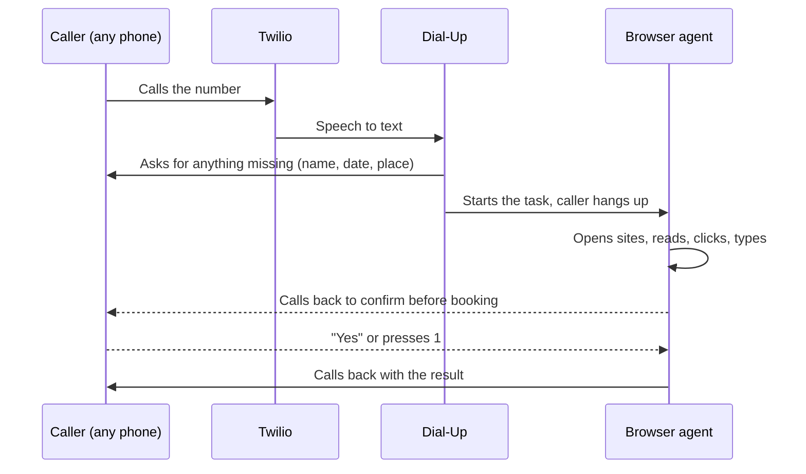

<p align="center">
  
</p>

<p align="center"><b>The internet, one phone call away.</b></p>

<p align="center">
  Call a number. Say what you need done. Hang up.<br>
  An AI agent does it on the web and calls you back.
</p>

---

3.1 billion people live within mobile internet coverage but don't use it (GSMA). Most don't own a smartphone, and many don't own a phone at all. A voice call works from any phone: basic, shared or borrowed.

Dial-Up turns that call into internet access. No app, no screen, no data plan. English or Chinese, by voice or SMS.

## What a call sounds like

> **You:** "Book me a flu shot at the community clinic this week, in the morning."
>
> **Dial-Up:** "What's the patient's full name?" ... "And their date of birth?"
>
> **Dial-Up:** "Got it. Book a morning flu shot this week for Maya Chen. I'm working on it and will call you back." *(you hang up)*
>
> *A minute later, the phone rings.*
>
> **Dial-Up:** "Book a flu shot for Maya Chen on Tuesday at 9 AM with Dr. Chen? Say yes or press 1."
>
> **You:** *(press 1)*
>
> *The phone rings again.*
>
> **Dial-Up:** "Booked. Tuesday, October 27, at 9 AM with Dr. Chen. Your confirmation is 8E655. Arrive 10 minutes early."

A simple question is answered before you hang up:

> **You:** "What time does the Apple Store at UTC close today?"
>
> **Dial-Up:** "One moment. I'll look that up." ... "It closes at 8 PM."

## How it works



1. **Intake.** Twilio turns the caller's speech into text. Before the call ends, Claude checks the request has what the task needs and asks follow-up questions on the same call.
2. **Work.** An agent drives a real browser with four general tools: open a page, read it, click, type. It isn't a scraper for one site.
3. **Check in.** If it needs something only the caller knows, it calls and asks. Before anything irreversible, it calls to confirm.
4. **Result.** It calls back with the answer. A simple lookup is answered on the first call instead.

**What it can do today:** book a clinic appointment or hold a bus seat on two demo sites, and look up facts (hours, prices, schedules) on the real web.

## Safe by design

The agent works alone for minutes at a time, so a supervisor (`agent/guards.py`) checks every step with measurable signals, not the agent's own opinion.

| Stop | Rule |
|---|---|
| Budget | Stops **before** the next model call would cross the per-task dollar cap (`COST_BUDGET`) |
| Loop | Same action 3 times in the last 8: one warning, then a stop |
| No effect | 3 clicks in a row that don't change the page: one warning, then a stop |
| Hard limits | Steps, minutes and tokens, plus a timeout that can interrupt a hung step |
| No answer | Two unanswered calls end the task politely; at most 4 calls to the caller per task |

Every ending (done, gave up, stopped, crashed) still calls the caller back, and a stopped task says what it found.

**Guardrails live in code, not just the prompt** (`agent/guardrails.py`):

- "Hold", "Book" and "Pay" clicks are blocked until the caller says yes or presses 1 on a confirm call.
- Password fields, card numbers (checksum-verified) and SSN-shaped text are never typed.
- Web page text is treated as data, never as instructions.
- Dial-Up never rings someone who is already on a call with it.

## Quick start

You need Python 3.10+, a Twilio number, an Anthropic API key and ngrok.

```bash
python -m venv .venv && source .venv/bin/activate
pip install -r requirements.txt
playwright install chromium
cp .env.example .env                # fill in your keys
```

Try it without a phone:

```bash
python scripts/smoke_test.py        # offline end-to-end check, no keys used
python -m pytest tests -q           # unit tests
python scripts/try_agent.py "Book me a flu shot this week"   # real agent, terminal as the phone
```

Run it for real:

```bash
ngrok http 8000                     # terminal 1
uvicorn dialup.app:app --port 8000  # terminal 2
```

Point your Twilio number's voice and SMS webhooks at the ngrok URL, open http://localhost:8000/live, and call. Full steps are in [docs/SETUP.md](docs/SETUP.md).

## Scaling to a billion people

This is a hackathon build: one server process, one Twilio number, two demo sites.

| Piece | Today | At scale |
|---|---|---|
| Reaching callers | One US number | Local or toll-free numbers per country through carrier partners, so calling costs nothing. The callback model fits the "missed call, we call you" habit common in many markets. |
| Phones | Any phone that can call; SMS too | Same. No app, no data plan, no account. |
| Server | One process, SQLite, in-memory call state | Stateless workers behind a queue, Redis/Postgres for state, a pool of browsers. The code already splits into telephony, tasks and agent. |
| Cost | About 5 cents of model time per task | Cheaper models for simple steps, caching, and partners who pay: telcos, NGOs, clinics, governments. |
| Languages | English and Chinese | Each language is one phrase file plus a voice config. |
| Websites | Two demo sites plus real-web lookups | Partner integrations for high-value services (clinics, benefits, transit); the open web for lookups. |
| Safety | Confirm in code, budget, no secrets | Plus caller verification for sensitive tasks and per-task audit logs (the journal already records every step). |

## Project layout

```
dialup/
├── app.py            FastAPI app and startup wiring
├── config.py         settings from .env, voice per language
├── i18n.py           every caller-facing phrase, English and Chinese
├── telephony/        Twilio: calls, texts, phone lines, TwiML
├── agent/            intake, task loop, browser tools, supervisor, guardrails
├── tasks/            task store (SQLite), event log, answer routing
├── web/live.py       live view for the projector
└── mock_sites/       demo sites: BusBook and Harbor Community Clinic
scripts/              smoke test and try_agent
tests/                unit tests
docs/                 setup, architecture, demo script
```

More detail in [docs/HOW-IT-WORKS.md](docs/HOW-IT-WORKS.md). The demo script is in [docs/DEMO.md](docs/DEMO.md).

## Stack

Twilio ConversationRelay (speech-to-text and text-to-speech), FastAPI, Claude tool use, Playwright, SQLite, Server-Sent Events.

## How we used AI coding tools

- **Kanwar** built the server, telephony, task store, live view and mock site in Cursor, with a project rules file (`.cursor/rules/dial-up.mdc`) that gives the assistant the architecture and coding rules on every change. _Kanwar: add anything distinctive here._
- **Sirui** used Claude to build the supervisor's dollar budget, the code-level guardrails, the confirm flow and the tests, first as a standalone prototype and then ported into this codebase in small, separately tested commits.
- **What we did differently:** we treated AI output as untrusted until it ran. Every commit passes the offline smoke test, and the prototype was tested with real model runs. Those runs caught a budget cap that overshot its limit (now predictive) and two API issues before they reached the shared code.

Built for c0mpiled-16, Track 4: AI-Powered Consumer Products for 1 Billion People.
