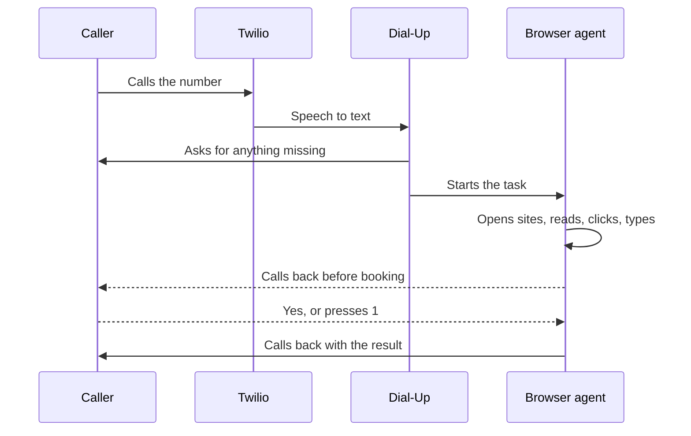

<p align="center">
  
</p>

<p align="center">
  <b>The internet, one phone call away.</b><br>
  Call a number. Say what you need done. Hang up.<br>
  An AI agent does it on the web and calls you back.
</p>

<p align="center">
  No app · No screen · No data plan · English or Chinese · Voice or SMS
</p>

---

3.1 billion people live where mobile internet works, but they don't use it. Most of them can make a phone call.

Dial-Up turns that call into internet access. Any phone works: a basic handset, a shared phone, a borrowed one.

## What a call sounds like

A booking stays on the line until the details are clear, then Dial-Up hangs up and works alone.

> **You:** "Book me a flu shot at the community clinic this week, in the morning."
>
> **Dial-Up:** "What's the patient's full name?"
>
> **You:** "Maya Chen."
>
> **Dial-Up:** "And their date of birth?"
>
> **You:** "May 27th, 2008."
>
> **Dial-Up:** "Got it. Book a morning flu shot this week for Maya Chen. I'm working on it and will call you back."
>
> *The phone rings.*
>
> **Dial-Up:** "Book a flu shot for Maya Chen on Tuesday at 9 AM with Dr. Chen? Say yes or press 1."
>
> **You:** *(press 1)*
>
> *The phone rings again.*
>
> **Dial-Up:** "Booked. Tuesday, October 27, at 9 AM with Dr. Chen. Confirmation 8E655. Arrive 10 minutes early."

A simple question is answered before you hang up.

> **You:** "What time does the Apple Store at UTC close today?"
>
> **Dial-Up:** "One moment. I'll look that up." … "It closes at 8 PM."

## How it works



1. **Intake.** Twilio turns speech into text. Claude asks follow-up questions on the same call until the task is clear.
2. **Work.** An agent drives a real browser with four tools: open a page, read it, click, type. It is not a scraper for one site.
3. **Check in.** If it needs something only the caller knows, it calls. Before anything irreversible, it calls to confirm.
4. **Result.** It calls back with the answer. A simple lookup is answered on the first call.

**What it can do today:** book a clinic appointment or hold a bus seat on two demo sites, and look up facts on the real web.

## Safe by design

The agent works alone for minutes at a time. A supervisor in `agent/guards.py` checks every step with measurable signals, not the agent's opinion.

| Stop | Rule |
|---|---|
| Budget | Stops **before** the next model call would cross the per-task dollar cap |
| Loop | Same action 3 times in the last 8: one warning, then a stop |
| No effect | 3 clicks in a row that don't change the page: one warning, then a stop |
| Hard limits | Steps, minutes, and tokens, plus a timeout that can interrupt a hung step |
| No answer | Two unanswered calls end the task; at most 4 calls to the caller per task |

Every ending still calls the caller back. A stopped task says what it found.

Rules in `agent/guardrails.py` are enforced in code, not just the prompt:

- "Hold", "Book", and "Pay" clicks are blocked until the caller says yes or presses 1.
- Password fields, card numbers, and SSN-shaped text are never typed.
- Web page text is treated as data, never as instructions.
- Dial-Up never rings someone who is already on a call with it.

## Quick start

You need Python 3.10+, a Twilio number, an Anthropic API key, and ngrok.

```bash
python -m venv .venv && source .venv/bin/activate
pip install -r requirements.txt
playwright install chromium
cp .env.example .env
```

Fill in `.env`, then try it without a phone:

```bash
python scripts/smoke_test.py
python -m pytest tests -q
python scripts/try_agent.py "Book me a flu shot this week"
```

Run it for real:

```bash
ngrok http 8000                     # terminal 1
uvicorn dialup.app:app --port 8000  # terminal 2
```

Point the Twilio number's voice and SMS webhooks at the ngrok URL. Open http://localhost:8000/live and call.

## Scaling to a billion people

This is a hackathon build: one server, one Twilio number, two demo sites.

| Piece | Today | At scale |
|---|---|---|
| Reaching callers | One US number | Local or toll-free numbers per country. The callback model fits the "missed call, we call you" habit in many markets. |
| Phones | Any phone that can call or text | Same. No app, no data plan, no account. |
| Server | One process, SQLite | Stateless workers, a queue, Postgres, a pool of browsers. Telephony, tasks, and the agent are already separate. |
| Cost | About 5 cents of model time per task | Cheaper models for simple steps, plus partners who pay: telcos, NGOs, clinics, governments. |
| Languages | English and Chinese | Each language is one phrase file plus a voice config. |
| Websites | Two demo sites plus real-web lookups | Partner integrations for clinics, benefits, and transit. The open web for lookups. |
| Safety | Confirm in code, budget, no secrets | Caller verification for sensitive tasks. The journal already records every step. |

## Project layout

```
dialup/
├── app.py            FastAPI app and startup
├── config.py         settings from .env, voice per language
├── i18n.py           every caller-facing phrase
├── telephony/        Twilio: calls, texts, phone lines, TwiML
├── agent/            intake, task loop, browser tools, supervisor
├── tasks/            SQLite store, event log, answer routing
├── web/live.py       live view for the projector
└── mock_sites/       BusBook and Harbor Community Clinic
scripts/              smoke test and try_agent
tests/                unit tests
docs/                 architecture
```

Architecture notes live in [docs/HOW-IT-WORKS.md](docs/HOW-IT-WORKS.md).

## Stack

Twilio ConversationRelay, FastAPI, Claude tool use, Playwright, SQLite, Server-Sent Events.

## How we used AI coding tools

- **Kanwar** built the server, telephony, task store, live view, and mock sites in Cursor, with a project rules file (`.cursor/rules/dial-up.mdc`) that gives the assistant the architecture and coding rules on every change.
- **Sirui** used Claude to build the supervisor's dollar budget, the code-level guardrails, the confirm flow, and the tests, first as a standalone prototype and then ported into this codebase in small, separately tested commits.
- **What we did differently:** we treated AI output as untrusted until it ran. Every commit passes the offline smoke test. Real model runs caught a budget cap that overshot its limit and two API issues before they reached the shared code.

Built for **c0mpiled-16**, Track 4: AI-Powered Consumer Products for 1 Billion People.
